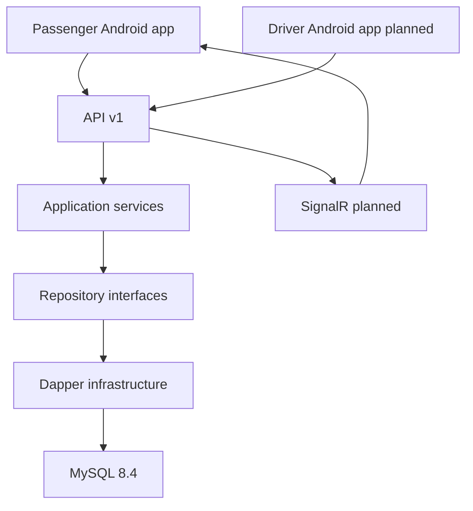

# System architecture

Two solutions are independently maintained. Android owns its API v1 models and references only Mobile.Core. The API composition root registers application services and MySQL repositories.

## Dependency rules

Domain has no dependency on Application, Infrastructure or API. Contracts contain transport DTOs. Application depends on Domain and Contracts. Infrastructure depends on Application. API is the composition root. Tests assert the main dependency rules. Client contains no project reference to Server.

## Current request path

The controller calls CatalogService. The service validates input and calls ICatalogRepository. Infrastructure opens a pooled MySQL connection, executes a parameterized Dapper command with cancellation and timeout, and returns results. The service maps to API DTOs. Unexpected server/database failures produce controlled problem details without SQL or connection strings.

## Planned writes

Tracking writes must use one transaction for validation, history insertion and latest-location advancement. Concurrent starts must rely on the database unique active-session keys. Durable event delivery requires an outbox before horizontal scaling; this foundation does not implement an outbox or SignalR publication.
