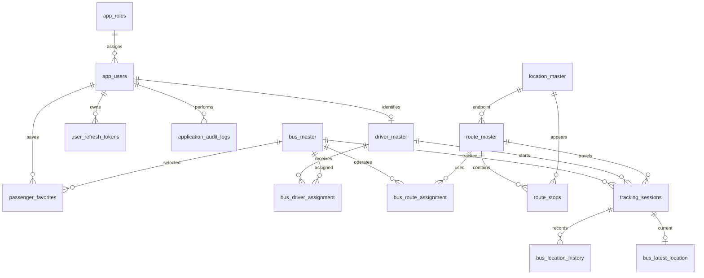

# Database design

Apply scripts 001 through 004 in order on a fresh MySQL 8.4 instance. Scripts create 15 InnoDB tables, foreign keys, validation constraints, indexes and sample catalog data. Scripts are versioned and intended to run once; they are not repeatable migrations. DDL may auto-commit, so back up before changes.

## Key integrity rules

Registration numbers are normalized in the application and stored uniquely. Route stop order is unique per route. Route searches require origin stop before destination stop. Generated nullable active bus/driver IDs enforce a single active session, while allowing multiple closed sessions. Compound foreign keys prevent a location from referencing a different bus than its session.

GPS update IDs are globally unique for idempotency. History capture and received times are separate UTC DATETIME(6) columns. Connection configuration uses DateTimeKind=Utc and the MySQL container uses UTC. Future writes must supply UTC timestamps explicitly.

Refresh token hashes use BINARY(32); passwords require a modern encoded password hash. No identity credentials are seeded. Hashing, token rotation and authentication are later implementation work.

## Retention

History retention is planned as a configurable scheduled delete job, using received_at index and bounded batches. No retention job runs in this foundation. Favorites for anonymous passengers are intended to be stored on device; the database table is reserved for future signed-in passengers.
