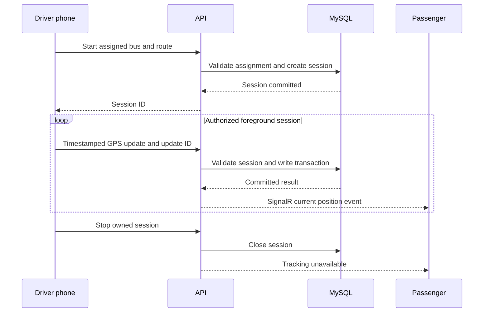

# Planned GPS tracking flow

GPS collection is not implemented in this foundation. The following sequence is the contract for Milestones 4 and 5.

The Android location service must be user initiated, visible through a persistent notification, and stopped on revoked consent or an ended session. Permission prompts appear only when a driver starts sharing. No collection is permitted outside an authorized active session.

Moving updates initially target ten seconds, with bounded durable buffering and backoff under network loss. Retry uses original timestamps and idempotency IDs. The server rejects invalid coordinates, unreasonable accuracy, future timestamps, expired sessions and unassigned driver updates.

Tracking state uses both capture time and receive time. Stale coordinates are delayed, even if received recently. The app may display an old location with its age but must not label it live. Arrival time must remain unavailable unless a reliable route-based estimator is implemented.
